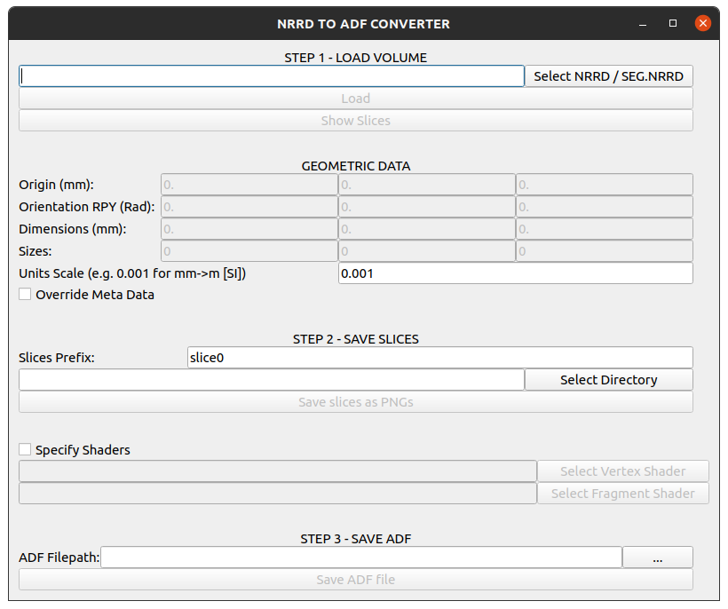

<!--toc:start-->
- [CONVERT NRRD AND SEGMENTATION NRRD FILES TO ADF FILES](#convert-nrrd-and-segmentation-nrrd-files-to-adf-files)
  - [Functionality 1: nrrd to ADF conversion](#functionality-1-nrrd-to-adf-conversion)
    - [Command line:](#command-line)
    - [GUI:](#gui)
  - [Functionality 2: Update nrrd with set of images](#functionality-2-update-nrrd-with-set-of-images)
<!--toc:end-->

# CONVERT NRRD AND SEGMENTATION NRRD FILES TO ADF FILES

Tools to convert NRRD volumes to ADF and back for AMBF simulations.


## Functionality 1: nrrd to ADF conversion 

**LPS coordinate convention:**
(Left      +x) <--> (Right     -x),
(Posterior +y) <--> (Anterior  -y),
(Superior  +z) <--> (Inferior  -z)

**Summary:** Save a segmented NRRD volume as a stack of images sliced along the
third (last) index of the voxel array, plus an ADF file describing the volume.
Image `i` is a rotated version of `data[:, :, i]`.

Before the images are generated, the voxel array is reindexed -- an axis
permutation followed by per-axis flips -- derived from the `space directions`
matrix in the NRRD header, so that (in LPS convention):
  * the 1st index runs along Left      (+x)
  * the 2nd index runs along Anterior  (-y)
  * the 3rd index runs along Inferior  (-z)

This makes the exported slices consistent from one volume to the next no matter
what axis order the scanner or 3D Slicer used to store them, and it matches the
fixed slicing convention of the AMBF multiview plugin. It can be turned off with
`--canonical_orientation False`, which keeps the source volume's native axis
order.

**Constraints:**
  * Each of the 3 voxel axes must run along L/R, A/P, or S/I (i.e. `space
    directions` must be a scaled signed permutation matrix, off-axis tilt < 1
    deg). Only then can the target layout be reached by a permutation + flips
    with no resampling.
  * Obliquely acquired volumes are rejected with an error. Resample them to an
    axis-aligned grid in 3D Slicer first, or run with
    `--canonical_orientation False`.


### Command line:
Run the Python script with the command line options

```bash
python3 nrrd_to_adf.py -n volume.nrrd -a volume.yaml
```

Check the available options via:

```bash
python3 nrrd_to_adf.py -h
```

### GUI:
Warning: This GUI has not been tested with CLI changes.

Run the GUI using the following command in a terminal
```bash
python3 nrrd_to_adf_gui.py
```
<p style="text-align: center"></p>

Test volumes can be found [here](example_assets/phantom_volumes/)


## Functionality 2: Update nrrd with set of images 

**Summary:**
Use `update_seg_nrrd_data_from_pngs.py` to update `.seg.nrrd` file with png
slices from a volume. Useful to observe changes in the volume in 3D slicer
Tested on Slicer `5.8.1` and Ubuntu 24.04

**Usage:**

```bash
python update_seg_nrrd.py \
    -n data/testing_data_cynthia/seg_post.seg.nrrd \
    -s data/testing_data_cynthia/seg_post.seg_slices \
    -p slice0 \
    -o seg_post_updated.seg.nrrd
```

